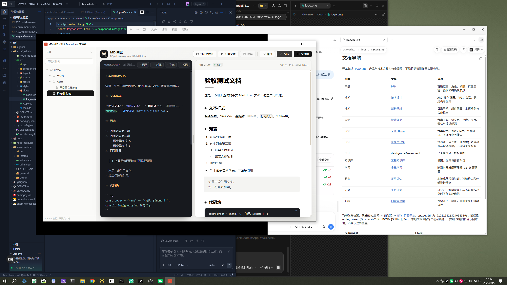

# MD 阅览

本地 Markdown 查看器：打开一个文件夹，所有 `.md` 文件在左侧列成树，点击即读；左侧可直接编辑，右侧实时预览。Windows 单文件 exe，约 3 MB，离线可用。

## 下载

到 [Releases](https://github.com/BestSu0921/md-viewer/releases) 下载：

- `MDViewer_1.1.0_x64-setup.exe` 安装版，带 `.md` 文件关联，双击文档直接打开
- `MDViewer_1.1.0_portable.zip` 免安装版，解压即用



## 功能

- **文件夹树浏览**：递归列出文件夹内所有 Markdown，支持文件名筛选、目录折叠状态记忆
- **双栏实时预览**：左侧编辑（带语法高亮、当前行高亮），右侧纸张感渲染，滚动位置双向同步
- **手写渲染器，零依赖**：标题 / 粗斜体删除线 / 行内代码 / 列表 / 引用 / 围栏代码块 / 分隔线 / 链接
- **本地资源解析**：文档里的相对路径图片自动加载；点击相对链接直接跳到对应 `.md`
- **文件关联**：安装版注册 `.md` / `.markdown`，双击文件直接打开；再次双击在同一窗口新开
- **会话记忆**：记住上次文件夹、文件、分栏比例、视图状态，下次启动自动恢复
- **外部修改监听**：文档被其他程序（如 AI Agent）修改时 1.5 秒内自动重载，编辑中不覆盖
- **编码兼容**：UTF-8 优先，GBK 自动回退（老文件不乱码）
- **5 套主题**：米杏 / 墨夜 / 青竹 / 靛蓝 / 曜白（白底黑字），顶栏面板选择切换
- **编辑辅助**：`Ctrl+S` 保存、`Ctrl+B` 加粗、`Ctrl+E` 行内代码、列表回车自动续行

## 配合 AI Agent

Agent 写 Markdown、你来读——三个接入层次：

1. **双击打开**：`.md` 已注册文件关联，Agent 执行 `start "" "D:\xxx\PRD.md"` 即弹出本软件（单实例，重复调用在同一窗口新开）
2. **边写边看**：开着本软件，Agent 修改文档时内容自动重载，无需手动刷新
3. **MCP 工具**：`md-open` MCP server（`open_md` / `preview_md` 两个工具，零依赖单文件，[agent-sync 仓库](https://github.com/BestSu0921/agent-syac) `mcp/md-open.mjs`），各 Agent 注册后可直接对话式打开文档

## 快捷键

| 按键 | 作用 |
| --- | --- |
| `Ctrl+S` | 保存当前文件 |
| `Ctrl+B` | 粗体 |
| `Ctrl+E` | 行内代码（编辑器内） |
| `Ctrl+\` | 显示 / 隐藏文件树 |

## 构建与运行

依赖：Node.js（仅用于 Tauri CLI）+ Rust + [Tauri 2 前置条件](https://tauri.app/start/prerequisites/)（Windows 上需 WebView2，Win10/11 自带）。

```bash
npx @tauri-apps/cli build
```

产物：

- 便携版：`src-tauri/target/release/md-viewer.exe`（单文件直接运行）
- 安装包：`src-tauri/target/release/bundle/nsis/MD Viewer_*.exe`（NSIS，含 `.md` 文件关联）

开发调试用 `npx @tauri-apps/cli dev`。

## 结构

```
dist/index.html      # 全部前端：界面、渲染器、文件树（单文件，无构建步骤）
src-tauri/           # Tauri 2 壳：文件树扫描、读写、编码回退、单实例
demo/                # 验收用示例文档（含子目录与本地图片）
app-icon.png         # 图标源文件（改后执行 npx @tauri-apps/cli icon app-icon.png）
```

前端是零依赖原生 JS，改完 `dist/index.html` 直接重新 build 即可，无 npm install 步骤。

## License

[MIT](LICENSE) © sqs
